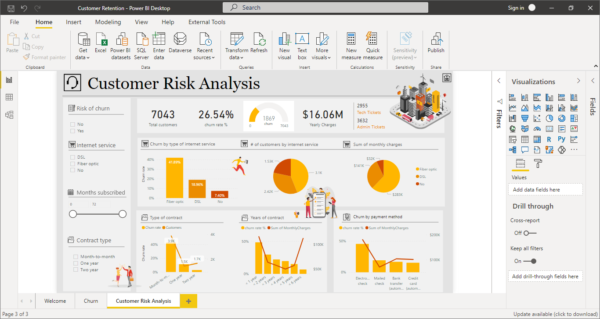
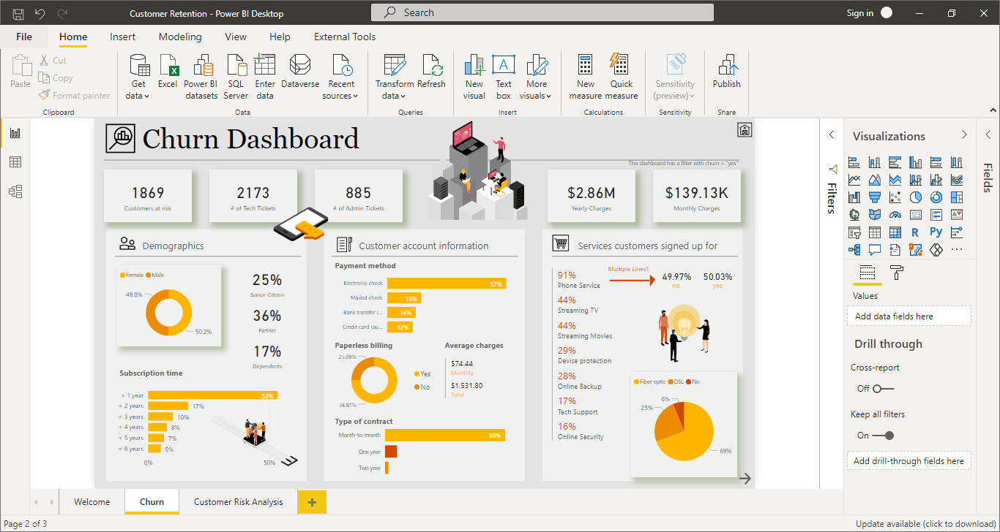

# Customer-Churn-Analysis-Prediction-Dashboard
An end-to-end Data Analytics and Machine Learning project designed to  identify customer churn drivers, predict high-risk customers,  and support data-driven retention strategies using Python,  Scikit-Learn, and Power BI
# 📊 Customer Churn Analysis & Prediction Dashboard


---

# 📌 Project Overview

Customer churn is one of the most important business challenges faced by subscription-based and service-oriented organizations. Understanding why customers leave and identifying customers who are likely to churn can significantly improve retention strategies and business profitability.

This project combines **Data Analysis**, **Machine Learning**, and **Power BI Dashboarding** to analyze customer behavior, uncover churn drivers, and predict future churners.

The solution enables organizations to:

- Identify churned customers
- Predict future churners
- Understand customer behavior patterns
- Measure revenue impact of churn
- Develop data-driven retention strategies
- Improve customer loyalty and profitability

---

# 📑 Table of Contents

- [📌 Project Overview](#-project-overview)
- [🎯 Business Problem](#-business-problem)
- [📂 Project Workflow](#-project-workflow)
- [🛠 Technologies Used](#-technologies-used)
- [📈 Dashboard 1: Customer Churn Analysis](#-dashboard-1-customer-churn-analysis)
- [🤖 Dashboard 2: Customer Churn Prediction](#-dashboard-2-customer-churn-prediction)
- [🧠 Machine Learning Pipeline](#-machine-learning-pipeline)
- [📊 Key Business Insights](#-key-business-insights)
- [💡 Business Recommendations](#-business-recommendations)
- [📁 Project Structure](#-project-structure)
- [🔮 Future Improvements](#-future-improvements)
- [👨‍💻 Author](#-author)

---

# 🎯 Business Problem

Customer acquisition costs continue to rise across industries. Retaining existing customers is significantly less expensive than acquiring new ones.

The primary objectives of this project are:

✔ Analyze customer churn patterns

✔ Identify key churn drivers

✔ Predict customers likely to churn

✔ Measure business impact of churn

✔ Improve customer retention strategies

✔ Support data-driven decision making

---

# 📂 Project Workflow

```text
Raw Customer Data
        │
        ▼
Data Cleaning
        │
        ▼
Exploratory Data Analysis
        │
        ▼
Feature Engineering
        │
        ▼
Machine Learning Model
        │
        ▼
Customer Churn Prediction
        │
        ▼
Power BI Dashboard
        │
        ▼
Business Insights & Recommendations
```

---

# 🛠 Technologies Used

## Data Analysis

- Python
- Pandas
- NumPy

## Data Visualization

- Power BI

## Machine Learning

- Scikit-Learn
- Random Forest Classifier
- Decision Tree Classifier
- Logistic Regression

## Development Tools

- Jupyter Notebook
- Git
- GitHub

## Database

- SQL
- SQL Server

---

# 📈 Dashboard 1: Customer Churn Analysis


This dashboard focuses on historical customer behavior and churn analysis.

## Executive KPIs

| KPI | Value |
|-------|-------|
| Total Customers | 3,000 |
| New Joiners | 200 |
| Total Churn | 849 |
| Churn Rate | 26.57% |

### Key Finding

More than one out of every four customers has churned, indicating a significant retention challenge.

---

## Customer Demographics Analysis

### Gender Analysis

| Gender | Churn Count |
|----------|------------|
| Female | 537 |
| Male | 312 |

### Insight

Female customers account for a larger share of total churn compared to male customers.

---

### Age Group Analysis

Age Groups:

- Less than 20
- 20 – 35
- 36 – 50
- Above 50

### Insight

Customers above 50 years demonstrate higher churn tendencies than younger age groups.

---

## Contract Analysis

### Findings

Monthly contract customers exhibit the highest churn rate.

Long-term customers with:

- One-Year Contracts
- Two-Year Contracts

show significantly better retention.

### Recommendation

Promote annual and multi-year contracts through discounts and loyalty programs.

---

## Internet Service Analysis

### Findings

Fiber Optic customers show the highest churn behavior.

### Possible Causes

- Competitive alternatives
- Service dissatisfaction
- Pricing concerns

---

## Payment Method Analysis

### Highest Churn

- Mailed Check
- Bank Withdrawal

### Lowest Churn

- Credit Card

### Recommendation

Encourage automated digital payment methods.

---

## Churn Category Analysis

Primary churn drivers identified:

1. Competitor
2. Dissatisfaction
3. Attitude
4. Price
5. Other

### Critical Insight

Competitor-related churn is the leading reason customers leave the company.

---

# 🤖 Dashboard 2: Customer Churn Prediction



This dashboard focuses on predicting customers likely to churn using machine learning techniques.

---

## Prediction Dashboard KPIs

| KPI | Value |
|-------|-------|
| Predicted Churners | 6,000+ |
| Total Revenue | $19.42 Million |

### Business Value

The prediction model enables proactive intervention before customers leave.

---

## State Analysis

Top customer regions include:

- Jammu & Kashmir
- Uttar Pradesh
- Tamil Nadu
- Maharashtra
- Haryana

These regions contain a large share of the customer base and should be prioritized for retention initiatives.

---

## Marital Status Analysis

Customer distribution is nearly balanced between married and unmarried customers, allowing deeper segmentation opportunities.

---

## Tenure Analysis

The majority of customers have remained with the company for more than 24 months.

### Insight

The organization has a strong loyal customer base that should be protected through targeted retention strategies.

---

## Revenue Analysis

### Total Revenue

**$19,422,108.84**

### Business Impact

Reducing churn by even a small percentage can save substantial revenue and improve long-term profitability.

---

# 🧠 Machine Learning Pipeline

## Data Preparation

The following preprocessing steps were performed:

- Missing Value Treatment
- Data Cleaning
- Label Encoding
- Feature Engineering
- Feature Selection
- Train-Test Split

---

## Models Evaluated

### Logistic Regression

Used as a baseline classification model.

### Decision Tree Classifier

Provides interpretability and feature importance.

### Random Forest Classifier

Offers improved accuracy and robustness.

---

## Final Selected Model

### Random Forest Classifier

The Random Forest model achieved the best overall performance and was selected as the final model for customer churn prediction.

### Benefits

- Handles nonlinear relationships
- Reduces overfitting
- Provides feature importance
- Strong predictive performance

---

# 📊 Key Business Insights

## Finding 1

Monthly contract customers have the highest probability of churn.

---

## Finding 2

Competitor-related churn is the dominant churn category.

---

## Finding 3

Fiber Optic customers demonstrate higher churn rates.

---

## Finding 4

Customers over 50 years require targeted retention initiatives.

---

## Finding 5

Credit card users exhibit stronger customer loyalty.

---

## Finding 6

Long-term customers show significantly lower churn risk than short-term customers.

---

# 💡 Business Recommendations

## Customer Retention

- Launch loyalty programs
- Offer renewal discounts
- Implement personalized retention campaigns

---

## Customer Experience

- Improve customer support services
- Address dissatisfaction issues
- Increase customer engagement

---

## Service Improvement

- Review Fiber Optic service quality
- Investigate competitor advantages
- Improve service reliability

---

## Revenue Protection

- Monitor high-value customers
- Predict churn before occurrence
- Focus retention efforts on high-risk customers

---

# 📁 Project Structure

```text
Customer-Churn-Analysis/
│
├── Data/
│   ├── Raw_Data.csv
│   └── Processed_Data.csv
│
├── Notebooks/
│   ├── Data_Cleaning.ipynb
│   ├── EDA.ipynb
│   ├── Feature_Engineering.ipynb
│   └── Model_Training.ipynb
│
├── Models/
│   ├── churn_model.pkl
│   └── label_encoders.pkl
│
├── Dashboard/
│   ├── Churn_Analysis.pbix
│   └── Churn_Prediction.pbix
│
├── Images/
│   ├── churn_analysis_dashboard.png
│   └── churn_prediction_dashboard.png
│
├── requirements.txt
│
└── README.md
```

---

# 🔮 Future Improvements

- Real-Time Churn Prediction API
- FastAPI Deployment
- Streamlit Web Application
- Automated Model Retraining
- Customer Lifetime Value Prediction
- Azure Cloud Deployment
- AWS Deployment
- MLOps Pipeline Integration

---

# 👨‍💻 Author

## Zekarias Adefris

**Data Analyst | Machine Learning Enthusiast | Full Stack Developer**

### Skills

- Python
- SQL
- Power BI
- Machine Learning
- Data Visualization
- SQL Server
- PostgreSQL

### Connect With Me

- [GitHub: https://github.com/your-github](https://github.com/zak2721)
- LinkedIn: [https://linkedin.com/in/your-linkedin](https://www.linkedin.com/public-profile/settings/?lipi=urn%3Ali%3Apage%3Ad_flagship3_profile_self_edit_contact_info%3BFjE5dWEZS8y9i5sCP01dRQ%3D%3D)

---

# ⭐ If You Found This Project Useful

If you found this project helpful, please consider giving it a star ⭐.

Your support helps increase project visibility and motivates future development.

---
